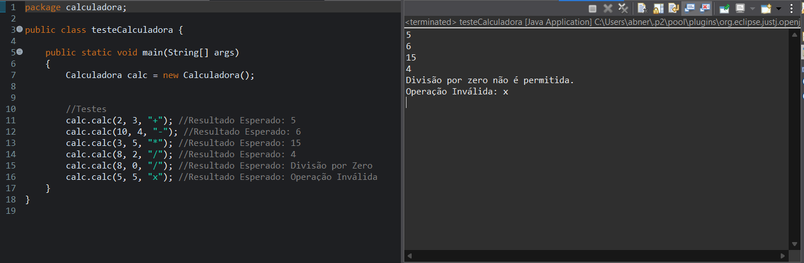
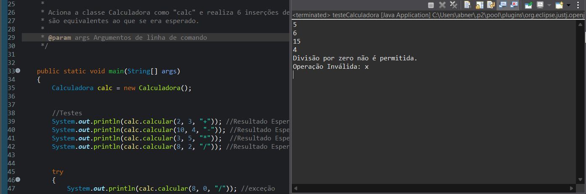
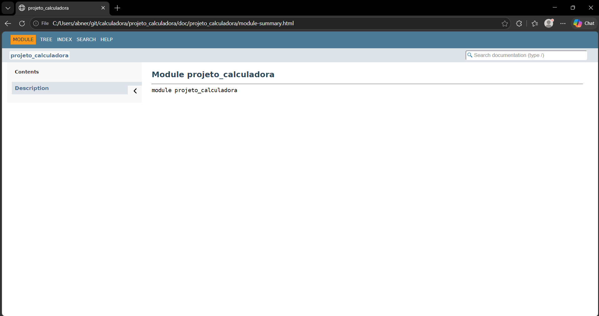
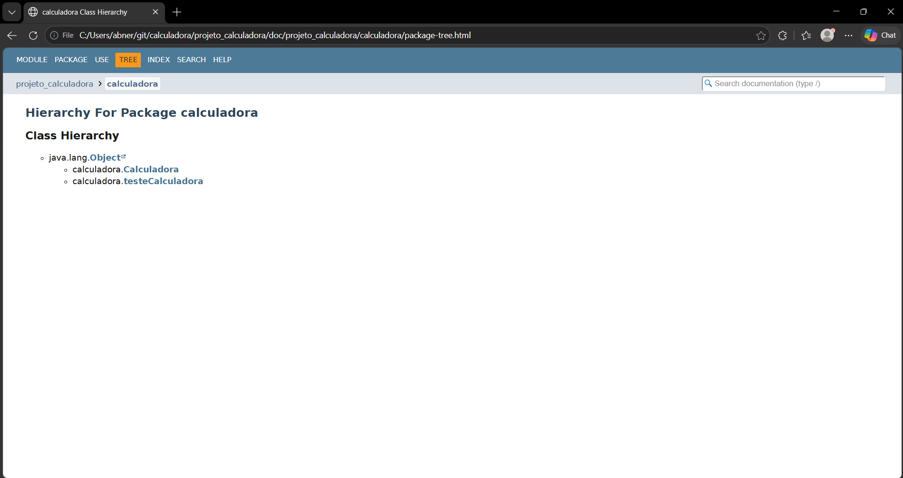
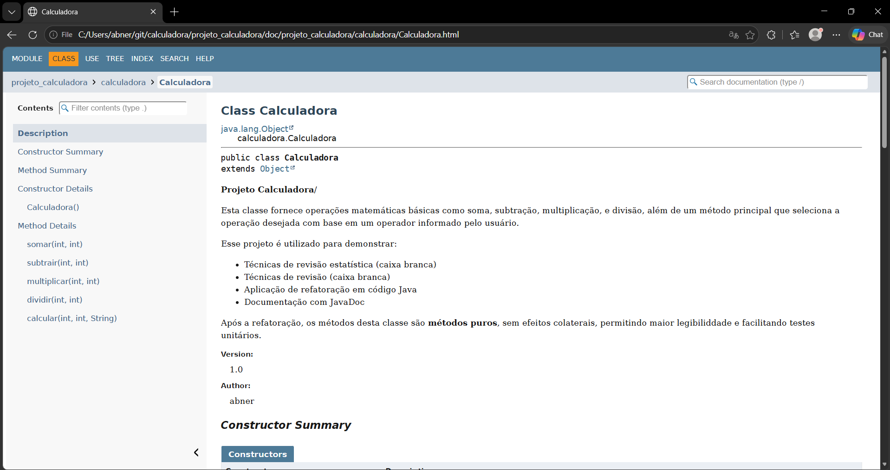
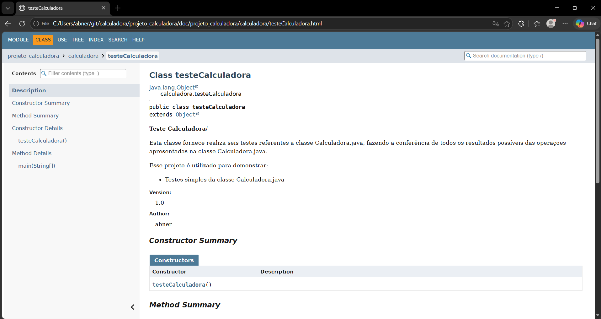

# Projeto Calculadora - UX/UI e Testes de Software - AF

> Projeto feito com o intuito de desmonstrar testes funcionais, refatoração e documentação de software.

---

## 1. Identificação do Projeto

**Projeto:** Projeto Calculadora

**Contexto:** AF - ATIVIDADE INDIVÍDUAL — TESTES FUNCIONAIS, REFATORAÇÃO E DOCUMENTAÇÃO DE SOFTWARE

**Aluno:** Abner Matheus Marques Rodrigues

**RA:** 247832  

**Curso:** Técnologia em Análise e Desenvolvimento de Sistemas

**Disciplina:** UX/UI e Testes de Software

**Professor:** Daniel Domingos Akira de Sá Pimentel Ohata

**Semestre:** 2026.2  

---

# 2. Descrição do Projeto

O projeto consiste no desenvolvimento de um módulo de cálculos matemáticos básicos em Java, com o intuito de simular uma calculadora simples.

O intuito do projeto não é analisar a programação ou a sintaxe, mas sim as boas práticas de:

- Testes funcionais;
- tratamento de erros;
- refatoração;
- documentação;
- versionamento;
- manutenção de código;

---

# 4. Objetivo

## 4.1 Objetivo Geral

Desenvolver uma calculadora em Java aplicando práticas de qualidade, testes, documentação, refatoração e versionamento.

## 4.2 Objetivos Técnicos

- implementar operações matemáticas básicas;
- tratar entradas inválidas;
- impedir divisão por zero;
- desenvolver testes automatizados;
- refatorar o código sem alterar seu comportamento;
- documentar classes e métodos com JavaDoc;
- gerar documentação HTML;
- utilizar Git e GitHub;
- organizar commits e branches;
- manter documentação técnica no README.

---

# 5. Escopo Funcional

A aplicação deverá oferecer as seguintes operações:

| ID | Funcionalidade | Descrição | Status |
|---|---|---|---|
| RF01 | Soma | Soma dois números inteiros | ✅ |
| RF02 | Subtração | Subtrai dois números inteiros | ✅ |
| RF03 | Multiplicação | Multiplica dois números inteiros | ✅ |
| RF04 | Divisão | Divide dois números inteiros | ✅ |
| RF05 | Validação de divisão | Impede divisão por zero | ✅ |
| RF06 | Operação inválida | Trata operadores não suportados | ✅ |

---

# 6. Requisitos Não Funcionais

| ID | Categoria | Requisito |
|---|---|---|
| RNF01 | Qualidade | O código deve possuir organização e legibilidade |
| RNF02 | Testabilidade | As operações devem possuir testes automatizados |
| RNF03 | Manutenção | O código deve permitir refatoração sem alteração funcional |
| RNF04 | Documentação | Classes e métodos devem possuir JavaDoc |
| RNF05 | Versionamento | O projeto deve utilizar Git e GitHub |
| RNF06 | Confiabilidade | Erros não devem interromper inesperadamente a execução |

---

# 7. Tecnologias Utilizadas

| Tecnologia | Versão | Utilização |
|---|---|---|
| Java | 25.0 | Desenvolvimento |
| JDK | 25.0 | Compilação |
| JUnit | 6.0 | Testes |
| Git | 2.56.0 | Controle de versão |
| GitHub | — | Repositório remoto |
| JavaDoc | — | Documentação |
| Eclipse IDE | 2026-09 | Ambiente de desenvolvimento |

---

# 8. Estrutura do Projeto


Branch Main
```text
├── projeto_calculadora/
│  ├── settings/ 
│  ├── src/
│      ├── calculadora/
│           └── Calculadora.java
│           └── TesteCalculadora.java
│  ├── .classpath
│  ├── .gitignore
│  └── .project
│
├── images/
│   ├── testes/
│   ├── javadoc/
│   └── refatoracao/
│
└── README.md
```

Branch Refatoracao
```text
├── projeto_calculadora/
│  ├── settings/ 
│  ├── src/
│      ├── calculadora/
│           └── Calculadora.java
│           └── TesteCalculadora.java
│  ├── doc/
│  ├── .classpath
│  ├── .gitignore
│  └── .project
│
├── images/
│   ├── testes/
│   ├── javadoc/
│   └── refatoracao/
│
└── README.md
```
---

# 8. Imagens dos Testes

TESTE INICIAL



TESTE REFATORADO



---

# 9. Imagens do JavaDoc

INDEX



TREE



calculadora.Calculadora



calculadora.testeCalculadora



---

# 10. Link do Repositório

https://github.com/AbnerMMRodrigues/247832_Teste_Caixa_Preta_AF_UI-UX.git
